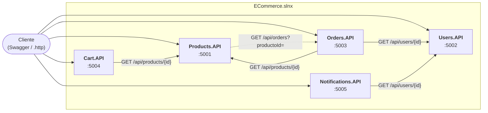
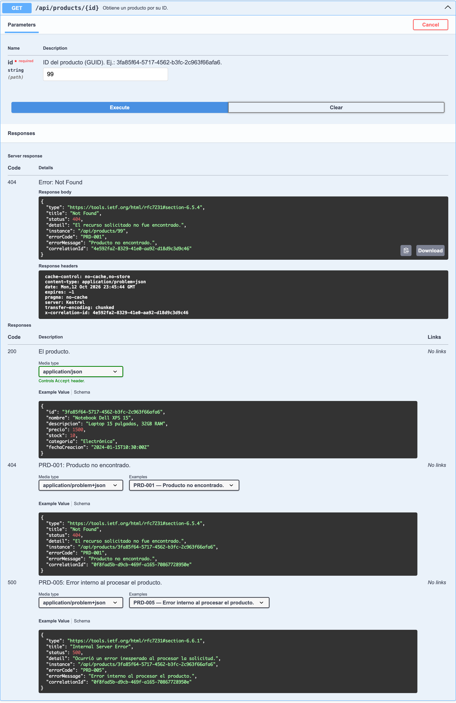

# E-Commerce con microservicios — Grupo 15

Trabajo práctico de **Construcción de Aplicaciones Informáticas**: un sistema de E-Commerce basado en una arquitectura de microservicios. Cada funcionalidad expone una REST API independiente en C# con **.NET 10**.

Integrantes: **Thomas** y **Juan Pablo**.

Cada servicio cumple los requisitos transversales del enunciado:

- un contrato de errores único con `errorCode` y `errorMessage`;
- manejo global de errores con `IExceptionHandler`;
- documentación con Swagger, con ejemplos de éxito y de error;
- logs estructurados con Serilog y Correlation ID;
- health checks.

---

## Servicios

| Servicio | Puerto | Responsabilidad | Consume a | Estado |
|---|---|---|---|---|
| **Products.API** | [5001](http://localhost:5001/swagger) | Catálogo de productos | Orders.API | ✅ Completo |
| **Users.API** | [5002](http://localhost:5002/swagger) | Registro, login y bloqueo de usuarios | — | ✅ Completo |
| **Orders.API** | [5003](http://localhost:5003/swagger) | Órdenes y su ciclo de estados | Users.API, Products.API | ✅ Completo |
| **Cart.API** | [5004](http://localhost:5004/swagger) | Carrito de compras | Products.API | ✅ Completo |
| **Notifications.API** | [5005](http://localhost:5005/swagger) | Notificaciones (envío simulado) | Users.API | ✅ Completo |

Los links abren Swagger UI con el servicio levantado. El detalle del avance está en el [plan de desarrollo](docs/planificacion/plan-de-desarrollo.md#estado-actual-18102026).

### Qué hace cada servicio

**Products.API** (5001): catálogo de productos con nombre, precio, stock y categoría.

- `GET /api/products` (filtros `?categoria=` y `?nombre=`) · `GET /api/products/{id}` · `POST /api/products` · `PUT /api/products/{id}` · `DELETE /api/products/{id}`
- No permite dos productos con el mismo nombre en una categoría. Antes de eliminar un producto le pregunta a Orders.API si tiene órdenes activas (Pendiente o Confirmada).

**Users.API** (5002): registro e inicio de sesión.

- `POST /api/users/register` · `POST /api/users/login` · `GET /api/users/{id}` (agregado por el grupo para Orders y Notifications)
- Guarda las contraseñas hasheadas. Al tercer intento fallido consecutivo bloquea la cuenta.

**Orders.API** (5003): órdenes de compra y su ciclo de estados.

- `GET /api/orders` (filtros `?usuarioId=` y `?productoId=`) · `GET /api/orders/{id}` · `POST /api/orders` · `PUT /api/orders/{id}/status`
- Al crear una orden verifica el usuario en Users.API y cada producto y su stock en Products.API, y toma el precio del producto. Estados: Pendiente → Confirmada → Enviada → Entregada, y Pendiente o Confirmada → Cancelada.

**Cart.API** (5004): un carrito por usuario.

- `GET /api/cart/{userId}` · `POST /api/cart/{userId}/items` · `PUT /api/cart/{userId}/items/{productId}` · `DELETE /api/cart/{userId}/items/{productId}` · `DELETE /api/cart/{userId}`
- Valida en Products.API que el producto exista y que alcance el stock. Si se agrega un producto que ya está en el carrito, suma la cantidad.

**Notifications.API** (5005): registro y envío simulado de notificaciones.

- `POST /api/notifications/send` · `GET /api/notifications/{userId}`
- Verifica en Users.API que el destinatario exista. Tipos: Email, Push y SMS.

## Arquitectura



<details>
<summary>El mismo diagrama en ASCII (si el Mermaid no se ve)</summary>

```
                 Cliente (Swagger UI / archivos .http)
                                  │
     ┌──────────────┬─────────────┼──────────────┬──────────────────┐
     ▼              ▼             ▼              ▼                  ▼
┌──────────┐  ┌──────────┐  ┌──────────┐  ┌──────────┐  ┌───────────────────┐
│ Products │  │  Users   │  │  Orders  │  │   Cart   │  │   Notifications   │
│  :5001   │  │  :5002   │  │  :5003   │  │  :5004   │  │       :5005       │
└──────────┘  └──────────┘  └──────────┘  └──────────┘  └───────────────────┘

Llamadas entre servicios (HTTP, con el header X-Correlation-Id):

  Cart          ── GET /api/products/{id} ────────▶  Products   existencia y stock
  Orders        ── GET /api/products/{id} ────────▶  Products   precio y stock
  Orders        ── GET /api/users/{id} ───────────▶  Users      el usuario existe (ORD-003)
  Notifications ── GET /api/users/{id} ───────────▶  Users      el usuario existe (NTF-001)
  Products      ── GET /api/orders?productoId= ───▶  Orders     órdenes activas (PRD-004)
```

</details>

Cada servicio es un proyecto independiente, es dueño de sus datos y se comunica con los demás solo por HTTP (`IHttpClientFactory`), propagando el header `X-Correlation-Id`. Si un servicio del que depende no responde, las operaciones que lo necesitan responden 500 con el código del servicio y el resto sigue funcionando. Además, el `/health/ready` del servicio que llama informa `Degraded`. Dentro de cada API, las capas dependen de interfaces:

```
Controller → Service → Repository (persistencia) / Clients (otros servicios)
                 └─ lanza excepciones con código del catálogo → IExceptionHandler → JSON de error
```

Diagramas de clases y de secuencia: [docs/arquitectura/arquitectura.md](docs/arquitectura/arquitectura.md).

> **Persistencia:** la librería de la cátedra todavía no fue entregada. Mientras tanto, cada servicio usa un repositorio en memoria detrás de una interfaz, con datos semilla para la demo. Cuando llegue la librería, solo cambia esa implementación.

---

## Cómo ejecutarlo

### Requisitos

- [SDK de .NET 10](https://dotnet.microsoft.com/download/dotnet/10.0). Verificar con `dotnet --version` (tiene que mostrar 10.x).

Los comandos son los mismos en macOS, Linux y Windows, y se ejecutan desde la raíz del repositorio.

### Compilar y correr los tests

```bash
dotnet build ECommerce.slnx
```

```bash
dotnet test ECommerce.slnx
```

Los tests no necesitan ningún servicio levantado: cada API se levanta en memoria y las llamadas a otros servicios se reemplazan por dobles de prueba. GitHub Actions corre lo mismo en cada push ([`.github/workflows/ci.yml`](.github/workflows/ci.yml)).

### Levantar los cinco servicios juntos

macOS y Linux:

```bash
./scripts/start-all.sh
```

Windows (PowerShell):

```bash
powershell -ExecutionPolicy Bypass -File scripts\start-all.ps1
```

Los dos scripts compilan la solución una vez, levantan las cinco APIs, esperan a que respondan y muestran sus URLs. En macOS y Linux los logs de los cinco salen en la misma terminal, cada línea con el nombre de su servicio, y **Ctrl+C** los detiene a todos. En Windows cada servicio abre su propia ventana con sus logs, y **Enter** los detiene.

### Levantar un servicio

Cada servicio se levanta en su propia terminal:

```bash
dotnet run --project src/Products.API --launch-profile http
```

```bash
dotnet run --project src/Cart.API --launch-profile http
```

Con `src/Users.API`, `src/Orders.API` y `src/Notifications.API` es igual. Cart.API necesita a Products.API levantado para agregar o actualizar productos; para ver un carrito, no. Orders.API necesita a Users.API y Products.API levantados para crear órdenes; para consultarlas o cambiar su estado, no.

### Probar un servicio

| Qué | Dónde |
|---|---|
| Swagger UI (documentación y pruebas) | `http://localhost:<puerto>/swagger` |
| Requests de ejemplo, de éxito y de cada error | `src/<Servicio>.API/<Servicio>.API.http` (VS Code con REST Client, Rider o Visual Studio) |
| Estado del servicio | `http://localhost:<puerto>/health`, `/health/ready` (incluye los servicios de los que depende) y `/health/live` |
| Logs | En la consola y en `src/<Servicio>.API/logs/*.json` (un archivo por día) |

Para seguir un request en los logs, mandar el header `X-Correlation-Id`: el mismo valor aparece en todos los logs del request, en el header de la respuesta, en el body de los errores y en los logs de los servicios a los que llama.

### Datos de prueba

Cada servicio arranca con datos semilla, con los IDs de los ejemplos del enunciado:

| Servicio | Datos |
|---|---|
| Products | `3fa85f64-5717-4562-b3fc-2c963f66afa6` Notebook Dell XPS 15 (stock 10) · `aaaabbbb-cccc-dddd-eeee-ffff00001111` Auriculares (stock 25) · `b2c3d4e5-0000-0000-0000-000000000005` Taladro (stock 2, para mostrar stock insuficiente) |
| Users | Contraseña de todos: `MiPassword123!` · `maria@email.com` activa (`a1b2c3d4-0000-0000-0000-111122223333`) · `juan@email.com` bloqueado por intentos (USR-004) · `carlos@email.com` bloqueado manualmente (USR-005) |
| Orders | La orden del ejemplo del enunciado (`f1e2d3c4-0000-0000-0000-aabbccddeeff`): de María, dos notebooks, **Pendiente**. Como es una orden activa, `DELETE /api/products/3fa85f64-5717-4562-b3fc-2c963f66afa6` responde PRD-004 apenas se levantan los servicios |
| Cart | El carrito de María (`a1b2c3d4-0000-0000-0000-111122223333`) con una notebook y tres auriculares |

Notifications arranca vacío: las notificaciones se crean con los IDs de arriba.

---

## Estructura del repositorio

```
├── .github/workflows/ci.yml   # integración continua: build + tests en cada push
├── ECommerce.slnx             # solución con los 10 proyectos
├── scripts/                   # start-all.sh/.ps1 levantan los cinco servicios; capture-swagger.py, las capturas
├── src/                       # las 5 APIs
│   └── <Servicio>.API/
│       ├── Controllers/       # traducen HTTP ↔ DTO
│       ├── Services/          # reglas de negocio
│       ├── Repositories/      # persistencia (en memoria por ahora)
│       ├── Clients/           # llamadas a otros servicios
│       ├── Models/ · DTOs/
│       ├── Exceptions/        # ErrorCodes y excepciones de dominio
│       ├── ExceptionHandlers/ # IExceptionHandler por tipo de excepción
│       └── Infrastructure/    # logging, Correlation ID, Swagger, health checks, DI
├── tests/                     # un proyecto de tests por API (Unit/ e Integration/)
└── docs/                      # documentación (índice en docs/README.md)
    ├── consignas/             # enunciado de la cátedra
    ├── planificacion/         # plan de desarrollo
    ├── arquitectura/          # diagramas
    ├── repasos/               # repaso general + uno por API
    └── capturas/              # capturas de Swagger UI con respuestas de error
```

## Documentación

| Documento | Contenido |
|---|---|
| [Consignas](docs/consignas/TP_Microservicios_ECommerce_v7.md) | El enunciado de la cátedra en Markdown ([`.docx` original](docs/consignas/TP_Microservicios_ECommerce_v7.docx)) |
| [Plan de desarrollo](docs/planificacion/plan-de-desarrollo.md) | Estado, decisiones de diseño (D-01 a D-39), convenciones de código, reparto de tareas y etapas |
| [Arquitectura](docs/arquitectura/arquitectura.md) | Diagramas del sistema, de clases y de secuencia |
| [Repaso general](docs/repasos/repaso-general.md) | Vista de conjunto: planificación, trabajo en equipo, arquitectura, revisiones y próximos pasos |
| [Repaso de Products.API](docs/repasos/repaso-products-api.md) | Cómo se construyó la plantilla de cada API, decisión por decisión |
| [Repaso de Cart.API](docs/repasos/repaso-cart-api.md) | Cómo se construyó el primer servicio que consume a otro |
| [Repaso de Users.API](docs/repasos/repaso-users-api.md) | Contraseñas, regla de bloqueo y el contrato del que dependen Orders y Notifications |
| [Repaso de Notifications.API](docs/repasos/repaso-notifications-api.md) | Envío simulado y el cliente HTTP de Users |
| [Repaso de Orders.API](docs/repasos/repaso-orders-api.md) | Máquina de estados de la orden y los clientes HTTP de Users y Products |

El índice completo, con los repasos pendientes de cada API, está en [docs/README.md](docs/README.md).

## Códigos de error

Todas las respuestas 4xx y 5xx siguen el contrato de la sección 3.1 del enunciado, más el campo `correlationId`:

```json
{
  "type": "https://tools.ietf.org/html/rfc7231#section-6.5.4",
  "title": "Not Found",
  "status": 404,
  "detail": "El recurso solicitado no fue encontrado.",
  "instance": "/api/products/99",
  "errorCode": "PRD-001",
  "errorMessage": "Producto no encontrado.",
  "correlationId": "0f8fad5b-d9cb-469f-a165-70867728950e"
}
```

Los catálogos son los de la [sección 4 de las consignas](docs/consignas/TP_Microservicios_ECommerce_v7.md#4-requerimientos-funcionales-y-contratos-de-api), más **USR-007**, agregado por el grupo (D-06). La columna `errorMessage` muestra lo que responde cada API; en los errores de validación (400) lista todos los problemas separados por `; ` (D-19). Un id de ruta que no es un GUID responde el 404 de "no encontrado" del servicio (D-17).

**Products.API**

| Código | HTTP | `errorMessage` | Cuándo |
|---|---|---|---|
| PRD-001 | 404 | Producto no encontrado. | `GET`, `PUT` o `DELETE` de un producto que no existe |
| PRD-002 | 400 | El nombre es obligatorio; El precio debe ser mayor a 0. | `POST` o `PUT` con datos faltantes o inválidos, o un JSON mal formado |
| PRD-003 | 409 | Ya existe un producto con ese nombre en la categoría 'Electrónica'. | `POST` de un producto con el mismo nombre en la misma categoría |
| PRD-004 | 409 | El producto tiene órdenes activas y no puede eliminarse. | `DELETE` de un producto con órdenes Pendiente o Confirmada en Orders.API |
| PRD-005 | 500 | Error interno al procesar el producto. | Error inesperado, u Orders.API no responde al eliminar (D-39) |

**Users.API**

| Código | HTTP | `errorMessage` | Cuándo |
|---|---|---|---|
| USR-001 | 409 | El email 'maria@email.com' ya está registrado. | `POST /register` con un email que ya existe |
| USR-002 | 400 | El email es obligatorio; La contraseña es obligatoria. | `POST /register` o `/login` con datos faltantes o de formato inválido |
| USR-003 | 401 | Credenciales incorrectas. | `POST /login` con un email inexistente o una contraseña incorrecta (el tercer intento fallido también, y bloquea la cuenta: D-09) |
| USR-004 | 403 | Su cuenta fue bloqueada por superar el máximo de intentos fallidos. Contacte a soporte. | `POST /login` de una cuenta bloqueada por 3 o más intentos fallidos (D-08) |
| USR-005 | 403 | Su cuenta fue suspendida por razones de seguridad. Contacte a soporte. | `POST /login` de una cuenta bloqueada manualmente (D-08) |
| USR-006 | 500 | Error interno al procesar el usuario. | Error inesperado |
| **USR-007** | 404 | Usuario no encontrado. | `GET /api/users/{id}` de un usuario que no existe. **Agregado por el grupo** (D-06) |

**Orders.API**

| Código | HTTP | `errorMessage` | Cuándo |
|---|---|---|---|
| ORD-001 | 404 | Orden no encontrada. | `GET /{id}` o `PUT /{id}/status` de una orden que no existe |
| ORD-002 | 400 | La orden debe tener al menos un item. | `POST` con datos faltantes, sin items o con cantidad ≤ 0; `PUT /status` con un estado desconocido |
| ORD-003 | 404 | Usuario no encontrado al crear la orden. | `POST` con un usuario que no existe en Users.API |
| ORD-004 | 404 | Producto no encontrado al crear la orden. | `POST` con algún producto que no existe en Products.API |
| ORD-005 | 422 | Stock insuficiente para 'Taladro percutor 750W'. Disponible: 2, solicitado: 5. | `POST` con una cantidad mayor al stock (D-34: los items repetidos se suman) |
| ORD-006 | 409 | Una orden en estado 'Entregada' no puede pasar a 'Pendiente'. | `PUT /status` con una transición no permitida |
| ORD-007 | 500 | Error interno al procesar la orden. | Error inesperado, o Users.API o Products.API no responden (D-36) |

**Cart.API**

| Código | HTTP | `errorMessage` | Cuándo |
|---|---|---|---|
| CRT-001 | 404 | Carrito no encontrado. | El usuario no tiene carrito (o lo vació: D-27) |
| CRT-002 | 404 | Producto no encontrado. | El producto no existe en Products.API, o no está en el carrito (D-26) |
| CRT-003 | 422 | Stock insuficiente. Disponible: 2, solicitado: 5. | La cantidad supera el stock (D-13: al agregar, se suma la del carrito) |
| CRT-004 | 400 | La cantidad debe ser mayor a cero. | Cualquier dato inválido o JSON mal formado (D-25) |
| CRT-005 | 500 | Error interno al procesar el carrito. | Error inesperado, o Products.API no responde (D-28) |

**Notifications.API**

| Código | HTTP | `errorMessage` | Cuándo |
|---|---|---|---|
| NTF-001 | 404 | El usuario destinatario no fue encontrado. | `POST /send` con un usuario que no existe en Users.API |
| NTF-002 | 400 | El tipo debe ser Email, Push o SMS. | `POST /send` con datos faltantes, mensaje de más de 500 caracteres o tipo no reconocido |
| NTF-003 | 404 | No se encontraron notificaciones para el usuario. | `GET /{userId}` de un usuario sin notificaciones, exista o no en Users (D-30) |
| NTF-004 | 500 | Error interno al procesar la notificación. | Error inesperado, o Users.API no responde (D-29) |

Cada endpoint devuelve únicamente los status de su contrato en el enunciado (D-12). La única excepción documentada es el 409 que el enunciado lista en `POST /api/orders`: ningún código del catálogo lo produce, así que no se devuelve (D-38).

### Capturas de Swagger UI

En [docs/capturas/](docs/capturas/README.md) hay una captura por servicio con una respuesta de error real (`errorCode`, `errorMessage` y `correlationId`) y los ejemplos documentados de cada endpoint. Por ejemplo, `GET /api/products/99`:



## Decisiones de diseño

El enunciado deja puntos sin definir. Cada uno se resolvió con una decisión explícita, registrada con su motivo en la [sección 5 del plan](docs/planificacion/plan-de-desarrollo.md#5-registro-de-decisiones). Este es el resumen:

**Estructura y diseño**

| # | Decisión | Por qué |
|---|---|---|
| D-01 | Solución `ECommerce.slnx` con `src/*.API` y `tests/*.Tests` | Estructura de la sección 6 del enunciado, más un proyecto de tests por API |
| D-02 | Controllers en lugar de Minimal API | El enunciado pide la carpeta `Controllers/` y XML comments en los controladores |
| D-03 | Persistencia en memoria detrás de una interfaz de repositorio | Avanzar sin la librería de la cátedra; cuando llegue, solo cambia la implementación |
| D-04 | `appsettings.Development.json` versionado | Define el nivel de detalle de los errores por entorno; no tiene secretos |
| D-05 | Sin librería compartida entre servicios | Cada microservicio es autónomo: un cambio en uno no obliga a coordinar los cinco |
| D-15 | Interfaces solo donde aportan desacoplamiento | Servicios, persistencia, otros microservicios y dependencias del entorno |
| D-16 | Solo HTTP en desarrollo | Llamadas entre servicios sin certificados ni redirecciones |

**Contratos entre servicios**

| # | Decisión | Por qué |
|---|---|---|
| D-06 | Endpoint adicional `GET /api/users/{id}`, con el código nuevo USR-007 | Orders (ORD-003) y Notifications (NTF-001) necesitan saber si un usuario existe |
| D-07 | Filtro adicional `?productoId=` en `GET /api/orders` | Products necesita saber si un producto tiene órdenes activas (PRD-004) |
| D-28, D-29, D-36 | Si el servicio del que se depende falla o no responde (timeout de 5 segundos), 500 con el código del servicio que llama (CRT-005, NTF-004, ORD-007) | Es una falla de infraestructura, no un dato del negocio |
| D-39 | Si Orders no responde, `DELETE /api/products/{id}` responde 500 (PRD-005) y **no** borra el producto | Sin saber si hay órdenes activas no se puede aplicar PRD-004, y un borrado no se puede deshacer |

**Contrato de errores**

| # | Decisión | Por qué |
|---|---|---|
| D-10 | `BusinessRuleException` lleva el status HTTP | El catálogo usa reglas de negocio con 401, 403, 409 y 422 |
| D-11 | Las respuestas de error incluyen `correlationId` | Requisito 5.5: buscar el error en los logs |
| D-12 | Cada endpoint devuelve solo los status de su contrato | Respetar el contrato de la API |
| D-17 | Los ids de ruta se reciben como texto | `/api/products/99` responde 404 con PRD-001, y no un 404 vacío del ruteo |
| D-18 | El `detail` de un 500 incluye el mensaje de la excepción solo en Development; nunca el stack trace | Requisito 5.2: detalle según el entorno |
| D-19 | JSON inválido → un único mensaje en español; los errores de validación se unen con `; ` | Los mensajes de .NET están en inglés; el enunciado pide listar los problemas |

**Observabilidad y documentación**

| # | Decisión | Por qué |
|---|---|---|
| D-20 | Un `X-Correlation-Id` recibido se acepta solo si tiene hasta 64 caracteres de `[A-Za-z0-9._-]` | El valor viene del cliente y termina en los logs y en otros servicios |
| D-21 | Serilog sin el logger estático | Con varias APIs levantadas en los tests, el logger estático hacía perder logs |
| D-22 | Swagger UI habilitado en todos los entornos | El enunciado lo pide y la demo se hace ahí |
| D-23 | Errores documentados con `[ProducesError]` propio | No hay paquete de ejemplos compatible con Swashbuckle 10 |
| D-24 | `/health/live` (proceso vivo) separado de `/health/ready` (persistencia y dependencias); una dependencia caída da `Degraded` | Un servicio puede estar vivo con una dependencia caída |

**Reglas de cada servicio**

| # | Servicio | Decisión | Por qué |
|---|---|---|---|
| D-08 | Users | Bloqueado con 3 o más intentos → USR-004; bloqueado con menos → USR-005 | El modelo no guarda el motivo del bloqueo |
| D-09 | Users | El tercer intento fallido responde 401 y bloquea; los siguientes, 403 aunque la contraseña sea correcta | La respuesta refleja el motivo de ese intento |
| D-32 | Users | El email se valida con `[RegularExpression]` | Un email vacío da un solo error, no dos |
| D-13 | Cart | Agregar un producto que ya está suma la cantidad; el stock se valida contra el total | Comportamiento esperable de un carrito |
| D-25 | Cart | Todo dato inválido responde CRT-004 | Es el único código 400 del catálogo de Cart |
| D-26 | Cart | Un producto que no está en el carrito responde CRT-002 | El catálogo no tiene un código para ese caso |
| D-27 | Cart | Vaciar el carrito lo elimina | Deja al usuario sin carrito activo |
| D-14 | Orders | Crear una orden no descuenta stock | El enunciado no lo exige |
| D-33 | Orders | `Order` tiene `FechaActualizacion` | La respuesta de `PUT /status` del enunciado la incluye |
| D-34 | Orders | Los items repetidos de una orden se suman | Si no, se podría pedir 3 + 3 de un producto con stock 5 |
| D-35 | Orders | Un usuario bloqueado puede comprar | El catálogo no tiene un código para ese caso; el bloqueo es para el login |
| D-37 | Orders | Un filtro que no es GUID devuelve `[]` | `GET /api/orders` solo admite 200 y 500 |
| D-38 | Orders | `POST /api/orders` no devuelve el 409 que lista el enunciado | Ningún código del catálogo lo produce al crear (pendiente de confirmar con los docentes) |
| D-30 | Notifications | El `GET` no consulta a Users: sin notificaciones → NTF-003 | El catálogo define NTF-001 solo para el `POST` |
| D-31 | Notifications | Se puede notificar a un usuario bloqueado | El bloqueo impide iniciar sesión, no recibir avisos |

## Forma de trabajo

- **TDD:** cada funcionalidad empieza por un test que falla. Hay tests unitarios (servicios, reglas y clientes HTTP con dobles de prueba) y tests de integración (la API en memoria con `WebApplicationFactory`).
- **Git:** se trabaja en `develop`, con commits de Commitizen (Conventional Commits), y en cada hito se abre un PR a `main`.
- **Integración continua:** GitHub Actions compila y corre todos los tests en cada push.
